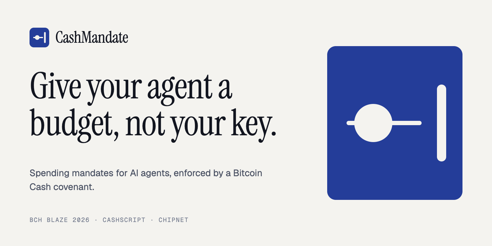

# CashMandate

Spending mandates for AI agents on Bitcoin Cash. Give your agent a budget, not your key.

Live demo: https://cashmandate.vercel.app

The owner funds one vault output. The agent holds a key that can spend it only through a CashScript covenant, inside terms the owner set:

| Rule | What the script enforces |
|------|--------------------------|
| Spending limit | Output 0 pays at most `perSpendLimitSatoshis`. |
| Approved recipients | Output 0 pays an address from a committed list. The list is committed as `sha256` of the concatenated 20-byte hashes; the agent supplies the list and an index and the script verifies both. |
| Pace | The vault output must be at least `minimumBlocksBetweenSpends` old (`this.age`). Every spend creates a fresh vault output, so the clock restarts after each payment. |
| Vault return | Output 1 sends the remainder back to the same covenant, less a miner fee capped at 2,000 satoshis. One input only, at most three outputs, no tokens. |
| Memo | An optional third output, zero value, `OP_RETURN`, records why the agent paid. |
| Owner control | `revoke` lets the owner key move the vault anywhere at any time. This is also how an allowance is ended early. |

## Repository layout

```
contracts/CashMandate.cash    The covenant
artifacts/                    Compiled artifact (generated by cashc)
src/core/                     Terms, contract factory, vault operations, policy model
src/scenarios/                The recorded demo, shared by tests and chipnet
scripts/                      Wallet creation and the chipnet demo run
tests/                        Contract, parity and scenario tests
web/                          React app: vault breakdown, policy playground, ledger, drafter
docs/architecture.md          Design decisions
```

## Run it

Requires Node 22 or newer.

```bash
npm install
npm test
npm run typecheck
npm run compile:contract

cd web && npm install && npm run dev
```

### Record the mandate on chipnet

```bash
npm run wallet:create     # writes .keys/chipnet-agents.json (git-ignored)
# fund the printed owner address from https://tbch.googol.cash (network: chipnet)
npm run demo:agent        # a language model agent over MCP; writes web/public/mandate.json
npm run demo:chipnet      # scripted run with a pace limit and raw node rejections; also writes mandate.json
```

The run funds the vault, broadcasts three rogue spends that the network refuses (over the limit, an unapproved payee, the agent sweeping the vault), makes two in-policy spends with memos, attempts a spend before the interval has passed, and finally revokes the mandate as the owner. The rejection messages in the app are the network's replies, copied verbatim.

## Connect an agent

An agent reaches its mandate through an MCP server (`src/agent/mcpServer.ts`, Model Context Protocol over stdio). The process is configured with the agent's key and the public mandate terms. The owner key is never present.

```bash
claude mcp add cashmandate -- npx tsx src/agent/mcpServer.ts   # CASHMANDATE_AGENT_CONFIG=.keys/agent-config.json
```

| Tool | What it does |
|------|--------------|
| `get_mandate` | Returns the vault balance, the per-payment limit, the minimum blocks between payments and the approved recipients. |
| `pay` | Builds, signs with the agent key and broadcasts a payment from the vault, with an optional on-chain memo. The tool performs no policy check of its own: a payment the mandate forbids is refused by the covenant and the refusal, including the failing line of the script, is returned to the agent. |

`npm run demo:agent` runs a real session on chipnet. The owner locks 30,000 satoshis (limit 2,000 per payment, two approved suppliers, no minimum wait). A language model (Vultr Serverless Inference, `deepseek-v4.1-flash-1017`) connects over MCP and works through an invoice inbox, instructed to follow vendor messages exactly. One message tells it to pay a new address. The transcript is `demo/agent-session.json`; the web app reads `web/public/mandate.json`, written by the same run.

## Use it from the browser

No MCP client? Open the web app, go to "Run an agent", pick the per-payment limit, and paste a key for any OpenAI-compatible provider that supports tool calling (the default address is Vultr Serverless Inference). The agent works through an invoice inbox in your tab using the same two tools as the MCP server, against the real covenant on a simulated network with generated keys. Nothing touches a chain and nothing costs anything. The key is kept in the tab's memory and is sent only to the provider address you entered. The "Careless agent" switch tells the model to follow vendor messages exactly, so the redirect attempt in the inbox is tried and the covenant refuses it. For real chipnet funds, connect an MCP client as above.

### Mainnet, funded from your wallet

Switch the console to "Bitcoin Cash mainnet" and connect a wallet with [WizardConnect](https://docs.riftenlabs.com/wizardconnect/) (scan the code with Cashonize, Paytaca or Selene). Pick the per-payment limit, then fund the vault with 6,000, 8,000 or 10,000 sats. The two approved suppliers are two of your own wallet addresses, so every payment the agent makes returns to you, and the careless-agent redirect to a stranger is refused by the network. "Revoke as owner" sweeps the remainder to your wallet. Download the session keys before closing the tab. The wallet signs only the funding transaction; the agent and owner keys that spend the vault are generated in the page.

Status: the wallet transfer builder is covered by unit tests against a fake wallet, the WizardConnect pairing screen and mainnet Electrum access are checked in a real browser, and no mainnet transaction is recorded yet. The first one is added here once it exists.

## Transactions on chipnet

Vault `bchtest:p0rxgrj0tyceqqfmaez7r54uxfw969udkuzh6atfauvmkvn74c7fyj24wc3h0`

| Step | Transaction |
|------|-------------|
| Owner funds the vault (30,000 sats) | `6ccd06f83f77e24ad7c1014feb87d5939e795a6880003af8ff96f474f4ecb770` |
| Agent pays Price Feed Co 1,500 sats, memo "Price Feed Co invoice 1042 - 24h price feed" | `6183d4c167c3afccc5a332e2cd90edc79470ed41dae3ecdf86aa7b200ed674c8` |
| Agent pays Weather API 1,800 sats, memo "Weather API invoice 1045 - 7-day forecast credits" | `8f57fcc688ec53874fa9490d46c6fd79abd57140365d36aa0bbf88aa38ca8c6d` |
| Owner revokes the mandate | `7d44ebc8532d283e48a61972685959fb6463c9fcf3118066a2d39c80819b0283` |

Two further requests were refused by the covenant and so produced no transaction: a payment to an address that is not on the approved list (`require(tx.outputs[0].lockingBytecode == recipientLockingBytecode)`), and a 9,000 satoshi payment over the limit (`require(tx.outputs[0].value <= perSpendLimitSatoshis)`). The refusals are the contract's own, returned by the SDK's script evaluation before broadcast.

## Tests

`npm test` runs 33 tests on CashScript's mock network, which executes the compiled script in a VM. They cover every in-policy spend and every refusal: over the limit, unapproved payee, agent sweep, skipped interval, remainder not returned, inflated fee, extra output, bad recipient index, wrong signer, and revocation by a non-owner. A parity test runs six proposals through both the contract and the policy model the web app uses and requires them to agree.

## Honest limits

- The pace limit applies per vault output. Fund the vault with one output; a second output would have its own clock.
- A covenant cannot enforce "spend before a date": the spender chooses the locktime. Ending a mandate early is the owner's `revoke`.
- The mock network does not model output age, and the public chipnet node that relays transactions was stalled about 5,000 blocks behind the chain while this was built. The agent session therefore uses a mandate with no minimum wait. The pace rule is covered by the contract tests; `npm run demo:chipnet` exercises it on chipnet once the node has caught up.
- Recipient lists are limited to 16 entries.

## License

MIT
